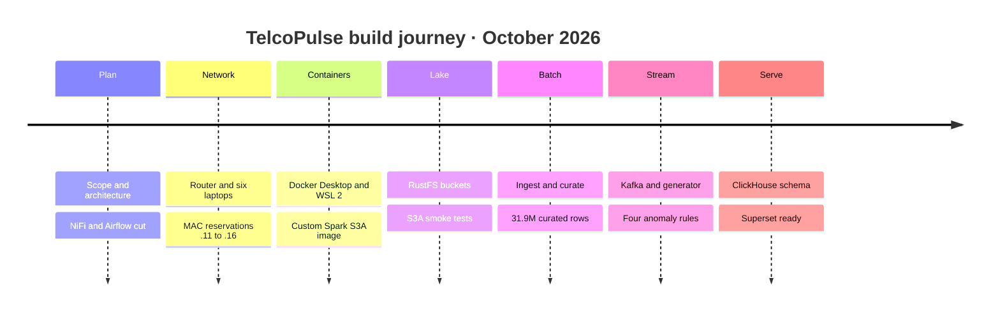
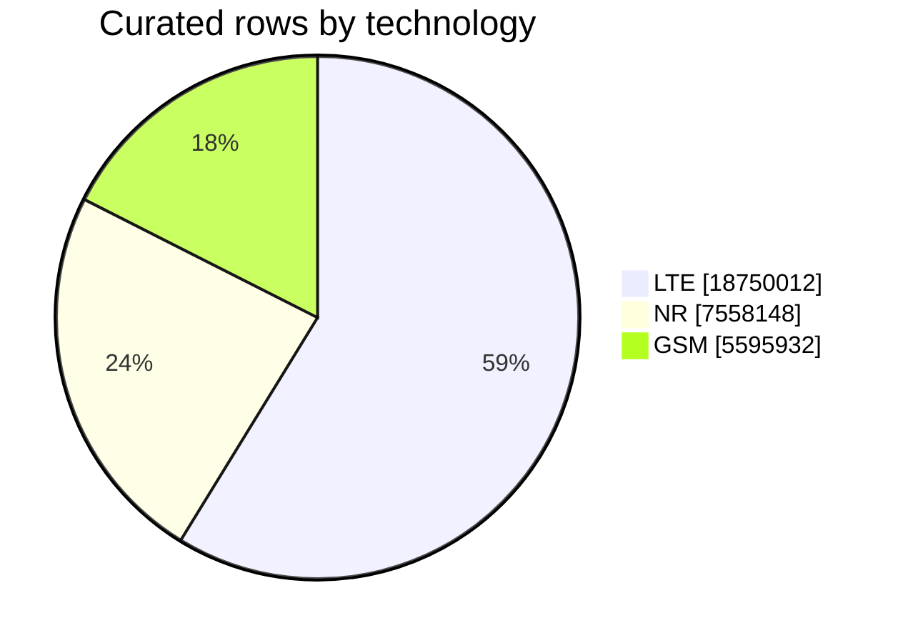
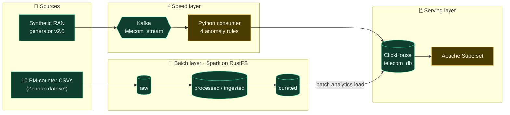
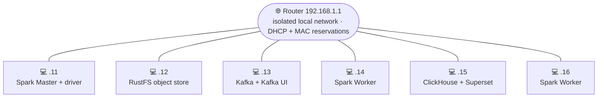
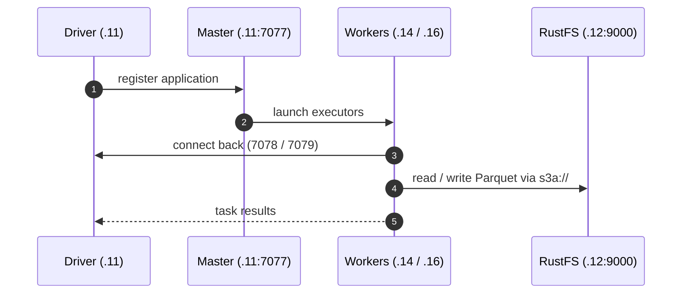
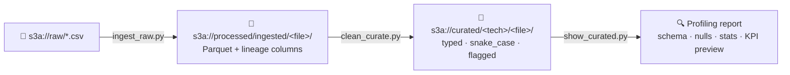
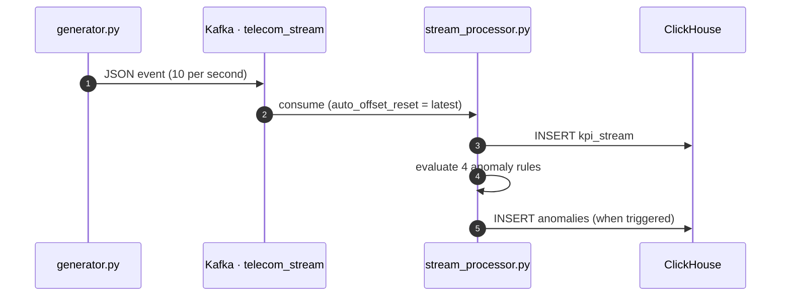
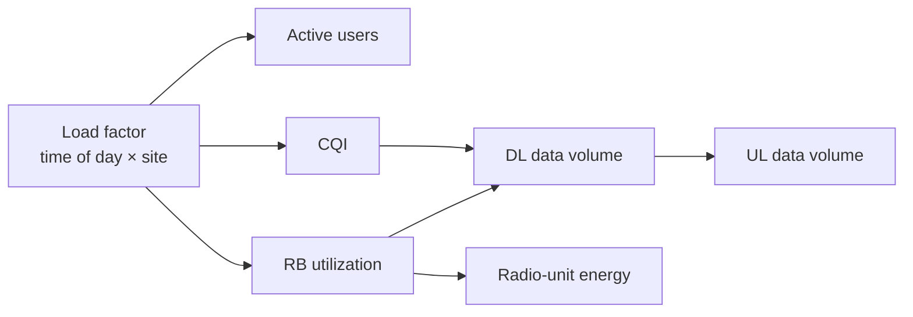
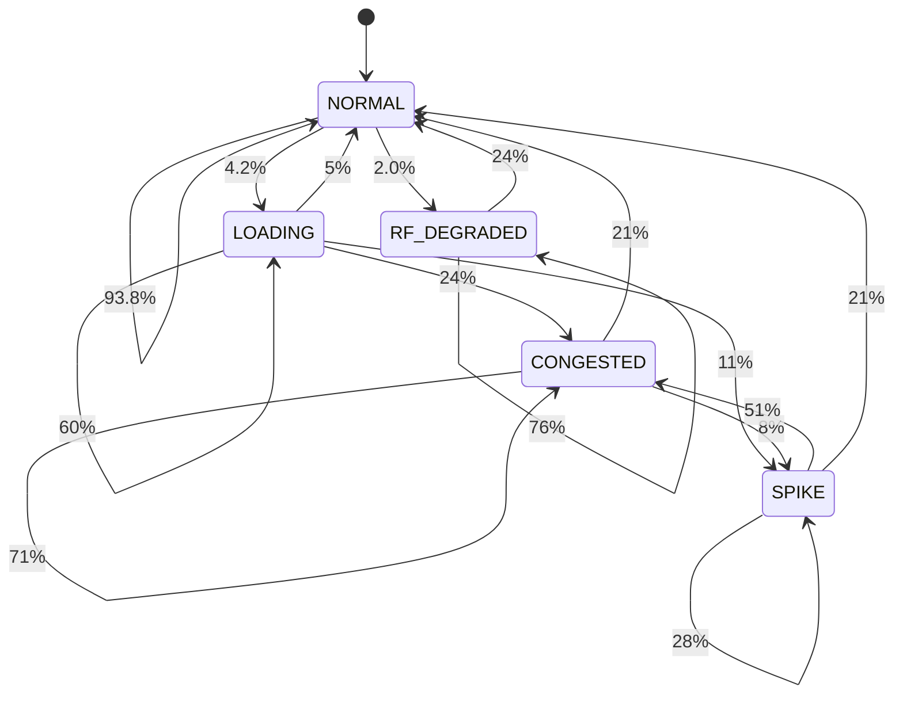
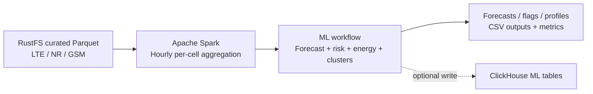

<div align="center">

<!-- ═════════════ PIPELINE SHOWCASE — FIRST ELEMENT ═════════════ -->


<a href="https://github.com/Mahmoud976/Telco_Pulse_V1">

</a>

<br/>


<br/>

<table align="center">
<tr>
<td align="center"><h2>31.9M</h2><sub>curated rows</sub></td>
<td align="center"><h2>279</h2><sub>base stations</sub></td>
<td align="center"><h2>3</h2><sub>technologies<br/>2G · 4G · 5G</sub></td>
<td align="center"><h2>6</h2><sub>physical laptops</sub></td>
<td align="center"><h2>10 / s</h2><sub>simulated events</sub></td>
<td align="center"><h2>5</h2><sub>ClickHouse tables</sub></td>
</tr>
</table>

<br/>

**[Overview](#overview) · [Results](#results) · [Architecture](#architecture) · [Network](#network) · [Spark](#spark) · [Data Lake](#datalake) · [Dataset](#dataset) · [Batch](#batch) · [Streaming](#streaming) · [Anomalies](#anomalies) · [Machine Learning](#machine-learning) · [ClickHouse](#clickhouse) · [Dashboards](#dashboards) · [Structure](#structure) · [Quick Start](#quickstart) · [Troubleshooting](#troubleshooting) · [Docs](#documentation) · [Conclusion](#conclusion) · [Team](#team) · [Supervisor](#supervisor) · [Thanks](#acknowledgements)**

</div>

<br/>

<a id="overview"></a>
<div align="center">


</div>

**TelcoPulse** is an end-to-end data engineering platform for **Radio Access Network (RAN) analytics**. It ingests historical 5G / 4G / 2G performance-management counters in batch **and** simulates a live telemetry feed, then serves both through a single analytical store with dashboards and automated anomaly detection.

The whole stack runs on a **six-laptop home-lab cluster** (`192.168.1.11` – `192.168.1.16`) joined by a local router. Spark, Kafka, ClickHouse/Superset and object storage live on separate nodes as Linux containers (Docker Desktop, WSL 2) — a realistic playground for distributed-systems problems: networking, listener configuration, S3A connectivity and cross-node data movement.

> [!IMPORTANT]
> TelcoPulse is a **local educational lab, not a production telecom deployment**. It processes public and synthetic data only. The streaming source is a **synthetic generator**, never a live operator feed.

### 📇 Project card

| | |
|---|---|
| 🏷 **Title** | TelcoPulse: A Distributed Telecom Big Data Analytics Platform |
| 🎓 **Programme** | Huawei HCIA Big Data training · National Telecommunication Institute (NTI) |
| 👨‍🏫 **Presented to** | Eng. Ahmed Hassan |
| 🗓 **Period** | October 2026 (ten days: eight implementation, two testing and evaluation) |
| 🖥 **Infrastructure** | 6 physical Windows laptops · Docker Desktop (WSL 2) · one local router |
| 📡 **Domain** | 2G / 4G / 5G RAN performance telemetry |
| 📚 **Documentation** | A complete project book accompanies the repo — see [Documentation](#documentation) |

### ✨ Highlights

| | Capability | What it does |
|:-:|---|---|
| 🧱 | **Medallion-style lakehouse** | `raw → processed/ingested → curated` Parquet layers on an S3-compatible object store |
| ⚡ | **Distributed Spark processing** | Custom Spark 3.5.9 image with `hadoop-aws` / AWS SDK baked in for S3A access |
| 📡 | **Realistic RAN simulator** | Circadian traffic, site profiles, tech × band calibration, correlated KPIs, Markov anomaly engine |
| 🚨 | **Real-time anomaly rules** | 4 rule-based detectors with severity grading and numeric anomaly scores |
| 🧠 | **ML use cases + platform diagnostics** | Capacity forecasting, congestion prediction, energy analysis, cell clustering and benchmark-based bottleneck diagnosis |
| 🗄️ | **Columnar serving layer** | ClickHouse `MergeTree` tables, partitioned and ordered for time-series queries |
| 📊 | **Analytics and dashboards** | ClickHouse analytical tables and Superset dashboards for batch/stream visibility |
| ✅ | **Data-quality audit** | Null / non-numeric / timestamp / duplicate-key checks with row-count reconciliation |

### 🧭 Scope decisions

| Item | Decision |
|---|---|
| Apache NiFi · Apache Airflow | **Cut from the ten-day scope** — not deployed |
| Live operator feed | **Excluded** — synthetic events only |
| High availability · production hardening | Not attempted |
| Hosts | Windows 10/11 laptops with Docker Desktop — no native Linux servers |

### 🛤 Project journey



<br/>

<a id="results"></a>
<div align="center">


</div>



| Metric | Value |
|---|--:|
| Source files | **10** CSV files (**9** reached the Curated layer) |
| Radio technologies | **3** — 2G GSM · 4G LTE · 5G NR |
| 🟦 LTE rows (curated) | **18,750,012** *(58.8 %)* |
| 🟪 NR rows (curated) | **7,558,148** *(23.7 %)* |
| 🟩 GSM rows (curated) | **5,595,932** *(17.5 %)* |
| **Total curated rows** | **31,904,092** |
| Rows carrying network metrics | 27,275,186 *(85.5 %)* |
| Distinct base stations | **279** (LTE, NR) · 263 (GSM) |
| Time range | `2023-03-03 08:30` → `2025-11-22 23:30` |
| Cluster | **6** laptops · 1 router |
| Stream rate (simulator) | **10 events / second** across 4 sites / 21 cells |

> [!NOTE]
> The earlier all-in-one job (`batch_all_10.py`) writes a different, intermediate *Processed* dataset (`telcopulse_batch_v1`; an earlier run reported 34,117,453 rows in 44 Parquet files). That figure is **not comparable** to the Curated totals — Curated is produced per file by `clean_curate.py`.

> [!CAUTION]
> `Dataset_03_NR_3500.csv` failed during ingestion (executors lost), so the NR figure and the grand total **exclude it**. See [Quick Start](#quickstart) for the one-file re-run.

<br/>

<a id="architecture"></a>
<div align="center">


</div>

TelcoPulse follows a **Lambda-style design**: a batch layer for historical data, a speed layer for live telemetry and a shared serving layer. The five logical layers are infrastructure → storage (RustFS) → processing (Spark, Kafka) → analytical storage (ClickHouse) → presentation (Superset); data quality and anomaly detection cut across them.



<div align="center">

🟩 Core pipeline components are connected in the implemented lab; see the notes below for scope and evidence boundaries.

</div>

### 🖥 Cluster layout



| Node | Role | Services | Key ports |
|---|---|---|:-:|
| `192.168.1.11` | **Compute** | Spark Master + driver | `7077` `8080` `7078` `7079` `4040` |
| `192.168.1.12` | **Object store** | RustFS (S3-compatible) | `9000` API · `9001` console |
| `192.168.1.13` | **Messaging** | Kafka broker (KRaft) + Kafka UI | `9092` · `8080` |
| `192.168.1.14` | **Compute** | Spark Worker | `8081` |
| `192.168.1.15` | **Serving** | ClickHouse + Superset | `8123` · `9000` · `8088` |
| `192.168.1.16` | **Compute** | Spark Worker | `8081` |

> [!NOTE]
> These are the private LAN addresses of the lab. Change them in `config/spark-defaults.conf`, the Kafka `ADVERTISED_LISTENERS`, and the Python connection constants to match your network.

### 🔀 Original design vs. what was built

The repository is the source of truth. Where the original design and the as-built system differ, **this README documents the as-built version**.

| Topic | Original design | As built |
|---|---|---|
| Stream engine | Spark Structured Streaming, 1-minute windows | Plain **Python Kafka consumer**; each event carries a 300 s window |
| Kafka address / topic | `192.168.1.12:9092` / `telco.events` | **`192.168.1.13:9092`** / **`telecom_stream`** |
| Anomaly detection | Rolling z-score (3σ) | **Four threshold rules** |
| Batch jobs | `batch_ingest_process`, `batch_curate`, `load_clickhouse_batch` | `ingest_raw.py`, `clean_curate.py`, `show_curated.py`, `batch_all_10.py` |
| Batch → ClickHouse | Curated data served for batch analytics | **Implemented and connected** |
| Curated layer | 10 files | **Curated outputs verified for LTE, NR and GSM; rerun the final NR 3500 MHz file if reproducing the earlier recorded run** |
| Superset dashboards | Six dashboard areas designed | **Superset dashboard is working; exact dashboard count depends on the final deployed configuration** |

<br/>

<a id="network"></a>
<div align="center">


</div>

Every service address is hard-coded in configuration (Spark master URL, S3A endpoint, Kafka advertised listener, ClickHouse URL). If a laptop received a new IP after a reboot, the cluster would break — so the lab uses **DHCP reservations** on the router.

### 🛜 Router facts

- A **Huawei HG531 V1** ADSL router (Vodafone-branded) provided only the **local network**. Its WAN side reported *Disconnected*, so the cluster is an **isolated LAN**.
- Gateway `192.168.1.1` · mask `255.255.255.0` · DHCP pool `192.168.1.2 – 254` · lease 1 day. Fixed addresses `.11`–`.16` are kept through **IP/MAC address reservations**.
- Laptops joined over a mix of Ethernet and Wi-Fi, so benchmarks must not be read as representative of a wired data-centre fabric.

> [!WARNING]
> With no Internet on the lab network, every container image, Maven JAR and dataset must be **downloaded before** the laptops join it.

### 🪜 Reserving fixed addresses

| Step | What to do |
|:-:|---|
| 1 | Connect all laptops to the same router (Wi-Fi or Ethernet). |
| 2 | On each laptop run `getmac /v` and note the MAC of the adapter that is **actually connected** (ignore VMware / Bluetooth adapters). |
| 3 | In the router: **Basic → LAN → DHCP → IP Address Reserve → New**. Enter the MAC (use `:` separators) and the fixed IP. |
| 4 | Reserve one address per laptop in `192.168.1.11 – 192.168.1.16`, then press **Submit**. |
| 5 | Reconnect each laptop and verify with `ipconfig`, `ping` and `Test-NetConnection -Port <port>`. |

> [!TIP]
> If a laptop does not get its reserved address, check that Windows *random hardware addresses* is off for the Wi-Fi network and that the reserved MAC belongs to the adapter really in use. Step-by-step screenshots are in the project book.

### 🐳 Containers

Every host is a Windows laptop running **Docker Desktop (WSL 2 backend)**; services run as Linux containers defined with Docker Compose. Persistent data lives on host paths (e.g. `G:/TelcoPulse/data/rustfs`).

### 📍 Four address concepts

| Concept | Example | Reachable from |
|---|---|---|
| Physical host IP | `192.168.1.12` | Every device on the LAN |
| Container IP | `172.17.x.x` (Docker bridge) | Inside that laptop only |
| Published host port | host `:9000` → container `:9000` | The LAN, via the host IP |
| **Service endpoint** | `192.168.1.12:9000` | What clients and executors must be configured with |

### 🩺 Layered connectivity validation

A successful `ping` proves only ICMP. Validate in layers:

```powershell
ping 192.168.1.11                                   # 1. reachability
Test-NetConnection 192.168.1.11 -Port 7077          # 2. TCP port
Invoke-RestMethod http://192.168.1.15:8123/ping     # 3. application level → "Ok."
```

<br/>

<a id="spark"></a>
<div align="center">


</div>

| Item | Value |
|---|---|
| Master container | `tp-spark-master` (`spark-class org.apache.spark.deploy.master.Master`) |
| Master endpoint | `spark://192.168.1.11:7077` · UI `:8080` |
| Base image | `apache/spark:3.5.9-scala2.12-java11-python3-r-ubuntu` |
| Application image | **`telcopulse-spark-s3a:3.5.9`** — adds `hadoop-aws 3.3.4` + `aws-java-sdk-bundle 1.12.262` |
| Driver networking | `spark.driver.host=192.168.1.11` · `bindAddress=0.0.0.0` · driver port `7078` · block manager `7079` |
| Workers | Containers on `.14` and `.16` (UI `8081`); observed executors: 2 cores · 1024 MB each |



> [!NOTE]
> Executors — not only the driver — read from storage, so the S3 endpoint must be reachable from **every** worker laptop and the driver ports must be reachable from every worker. Pinning driver and block-manager ports makes firewall rules predictable. In `config/spark-defaults.conf`, the `spark.master.*` lines are not real Spark properties and have no effect — the Master is configured by the arguments in `Docker/spark-compose.yml`.

<br/>

<a id="datalake"></a>
<div align="center">


</div>

Three buckets separate data by processing stage, protecting original data and giving downstream consumers a stable, cleaned dataset.

| Zone | Purpose | Format | Path |
|---|---|---|---|
| 🥉 **Raw** | Original ingested data, unchanged | CSV | `s3a://raw/Dataset_*.csv` |
| 🥈 **Processed** | Intermediate stage with lineage columns | Parquet | `s3a://processed/ingested/<file>/` |
| 🥇 **Curated** | Final cleaned, typed datasets | Parquet | `s3a://curated/<lte\|nr\|gsm>/<file>/` |

**S3A settings** (path-style addressing, because a bare IP has no DNS name for virtual-hosted buckets):

| Property | Value |
|---|---|
| `fs.s3a.endpoint` | `http://192.168.1.12:9000` |
| `fs.s3a.path.style.access` | `true` |
| `fs.s3a.connection.ssl.enabled` | `false` (plain HTTP inside the isolated lab) |
| `fs.s3a.aws.credentials.provider` | `SimpleAWSCredentialsProvider` |
| Credentials | environment variables `AWS_ACCESS_KEY_ID` / `AWS_SECRET_ACCESS_KEY` |

> [!NOTE]
> The final implementation uses **RustFS**. Early design material and the early host folder name (`data\minio`) refer to MinIO — treat those as historical; the two products have different images, consoles and configuration.

### 🧰 Tech stack

| Layer | Technology | Purpose |
|---|---|---|
| **Object storage** | RustFS | S3-compatible lake with `raw`, `processed`, `curated` buckets |
| **Batch compute** | Apache Spark 3.5.9 (PySpark) | Ingestion, cleaning, curation, profiling |
| **S3 connector** | `hadoop-aws 3.3.4` + `aws-java-sdk-bundle 1.12.262` | `s3a://` access from Spark |
| **Messaging** | Apache Kafka 4.1.0 (KRaft, no ZooKeeper) | Real-time telemetry transport |
| **Kafka tooling** | Kafka UI (Provectus) | Topic / consumer inspection |
| **Stream processing** | Python · `kafka-python` · `requests` | Consume → write KPIs → detect anomalies |
| **Simulation** | Python · NumPy | Physically-correlated synthetic RAN telemetry |
| **Warehouse** | ClickHouse | Columnar OLAP serving layer |
| **BI** | Apache Superset + `clickhouse-connect` | Dashboards and exploration |
| **Orchestration** | Docker · Docker Compose · PowerShell · Bash | Reproducible deployment |

<br/>

<a id="dataset"></a>
<div align="center">


</div>

Historical data comes from live-network **performance-management counters** published on Zenodo ([`10.5281/zenodo.17815388`](https://doi.org/10.5281/zenodo.17815388)), recorded at **15-minute intervals** (about 767 MB as initially reported). The generator's behaviour is additionally calibrated against 4G LTE field traces ([`10.5281/zenodo.1219679`](https://doi.org/10.5281/zenodo.1219679)).

**10 CSV files · 3 dataset groups · 3 radio technologies · 6 frequency bands.** Technology and frequency are parsed from the file name (`Dataset_<group>_<TECH>_<MHz>.csv`) and attached as columns during ingestion.

| File | Tech | Band (MHz) | Curated rows | Duplicate keys · extra rows | Rows with metrics |
|---|:-:|:-:|--:|--:|--:|
| `Dataset_01_LTE_2100` | 4G LTE | 2100 | 151,026 | 0 · 0 | 147,470 |
| `Dataset_01_NR_1800` | 5G NR | 1800 | 151,026 | 0 · 0 | 147,470 |
| `Dataset_02_LTE_1800` | 4G LTE | 1800 | 1,800,920 | 722,137 · 1,078,375 | 690,402 |
| `Dataset_02_NR_2100` | 5G NR | 2100 | 1,800,920 | 722,137 · 1,078,375 | 690,514 |
| `Dataset_03_GSM_900` | 2G GSM | 900 | 5,595,932 | 0 · 0 | 5,049,216 |
| `Dataset_03_LTE_1800` | 4G LTE | 1800 | 5,606,202 | 0 · 0 | 5,467,773 |
| `Dataset_03_LTE_700` | 4G LTE | 700 | 5,595,932 | 0 · 0 | 4,042,663 |
| `Dataset_03_LTE_800` | 4G LTE | 800 | 5,595,932 | 0 · 0 | 5,571,889 |
| `Dataset_03_NR_2100` | 5G NR | 2100 | 5,606,202 | 0 · 0 | 5,467,789 |
| `Dataset_03_NR_3500` | 5G NR | 3500 | ⚠️ *not processed* | — | — |

<details>
<summary><b>🔍 Field notes before you aggregate</b></summary>

<br/>

| Field | Caution |
|---|---|
| `rb_utilization` and other percentages | **Average** them — never sum |
| `data_volume_dl/ul` | May be a cumulative counter, not an interval increment — check the dataset definition before any `SUM` |
| `active_users_*` vs `max_active_users_*` | Different statistics — do not mix |
| LTE vs NR vs GSM | Compare as separate series; do not blend into one average |
| Energy columns | Unit follows the source dataset; do not assume kWh |

</details>

<br/>

<a id="batch"></a>
<div align="center">


</div>

Three PySpark jobs implement a clean **raw → ingested → curated** flow. Each is re-runnable per file and prints greppable, prefixed log lines (`INGEST`, `CHECK`, `CLEAN`, `DONE`, `SHOW`).



### 1️⃣ `ingest_raw.py` — Raw → Processed

- Reads every CSV with `header=true` and **no schema inference** (everything stays a string, so nothing is silently coerced).
- Adds lineage columns `source_file`, `technology`, `frequency_mhz`, `processed_at`.
- Writes Parquet and **re-reads it to verify** `rows_in == rows_out` (`OK` / `MISMATCH`).

### 2️⃣ `clean_curate.py` — Quality audit + curation

| Check | Description |
|---|---|
| ⏱ **Timestamp parse failures** | Rows whose `Timestamp` cannot be parsed |
| 🔑 **Null keys** | Rows missing `Base station` or `Sector` |
| 🕳 **Empty values** | Per-column count of null / blank metric cells |
| 🔤 **Non-numeric values** | Per-column count of values that fail `cast("double")` |
| 👯 **Duplicate keys** | Duplicates on `(Base station, Sector, Timestamp)` — **reported, never deleted** |
| ⚖️ **Row reconciliation** | Output row count must equal input row count |

Curation then normalizes names to **`snake_case`**, strips technology prefixes (`4G `, `5G `, `2G `), casts KPIs to `double`, maps `Timestamp` → `ts`, and adds **`has_network_metrics`** — true when at least one KPI is present (energy-only rows stay, but are distinguishable). Output goes to `s3a://curated/<lte|nr|gsm>/<dataset>/`.

### 3️⃣ `show_curated.py` — Profiling

Per technology: schema, rows per source file, time range, distinct stations/sectors, null counts, `count/min/mean/max`, sample rows, and KPI previews per frequency and per hour of day.

### 🧪 `batch_all_10.py` — single-pass alternative

An earlier all-in-one version that reads all ten files, tags them, unions them with `unionByName(allowMissingColumns=True)` and writes one Parquet dataset (`repartition(12)`) to `s3a://processed/telcopulse_batch_v1/`.

### 📊 Recorded results

| Measure | LTE | NR | GSM |
|---|--:|--:|--:|
| Source files curated | 5 | 3 *(no NR_3500)* | 1 |
| **Rows** | **18,750,012** | **7,558,148** | **5,595,932** |
| Rows with network metrics | 15,920,197 | 6,305,773 | 5,049,216 |
| Distinct base stations | 279 | 279 | 263 |
| Time range | 2023-03-03 → 2025-11-22 | 2023-03-03 → 2025-11-22 | 2025-08-31 → 2025-11-22 |

14.5 % of curated rows are energy-only (no network metrics); they are kept but flagged.

<details>
<summary><b>🕒 Run history — 21 October 2026</b></summary>

<br/>

| Job | Start | What happened |
|---|---|---|
| `ingest_raw.py` | 16:53 | First Master connection refused; retry succeeded 20 s later. Files 1–8 reported `OK` over ≈ 50 min with heartbeat-timeout executor losses along the way. File 9 (`Dataset_03_NR_3500`) never reported — executors lost, driver disconnected |
| `clean_curate.py all` | 18:31 | Nine files audited and curated `OK`; the tenth stopped with `UNABLE_TO_INFER_SCHEMA` (no Parquet existed) |
| `show_curated.py` | 18:59 | Profiled LTE, NR and GSM successfully |

No file had unparseable timestamps, null stations/sectors, or non-numeric metric values.

</details>

<br/>

<a id="streaming"></a>
<div align="center">


</div>



### 📨 Kafka

| Item | Value |
|---|---|
| Image / mode | `apache/kafka:4.1.0` · KRaft single node (no ZooKeeper) · container `kafka-broker` |
| Listeners | `INTERNAL :29092` · `EXTERNAL :9092` · `CONTROLLER :9093` |
| Advertised | `INTERNAL://kafka:29092` · `EXTERNAL://192.168.1.13:9092` |
| Topic | `telecom_stream` |
| UI | Kafka UI (Provectus) on `:8080`, cluster `TelcoPulse-Cluster` |

> [!TIP]
> Kafka reachable *inside* Docker but not from other laptops is almost always the advertised-listener setting. Keep a dedicated `EXTERNAL` listener advertising the host's LAN address.

### 📡 Synthetic RAN generator `v2.0`

One event every **0.1 s**, each representing a **5-minute measurement window**, across **4 sites / 21 cells**.

| Design pillar | Details |
|---|---|
| 🌅 **Circadian traffic model** | Dual Gaussian peaks (business ≈ 10:00, evening ≈ 20:00), separate weekday / weekend curves |
| 🏙 **Site profiles** | Urban, suburban, rural — each with its own load scale and tech/band stack |
| 📻 **Tech × band calibration** | Separate KPI envelopes for 4G @ 1800 / 2100 and 5G @ 3500 / 1800 |
| 🔗 **Correlated KPI chain** | load → users → RB utilization → CQI → throughput volume → UL ratio → energy |
| 🎲 **Markov anomaly engine** | 5-state per-cell chain with realistic transition probabilities |
| 📈 **Log-normal noise** | Captures bursty, right-skewed real-world traffic |

| Site | Type | Tech / band | Sectors | Load scale |
|---|---|---|:-:|:-:|
| Site 36 | Urban | 4G@1800 · 5G@3500 | 3 | 1.20 |
| Site 42 | Urban | 4G@2100 · 5G@3500 | 3 | 1.10 |
| Site 88 | Suburban | 4G@1800 · 4G@2100 | 3 | 0.75 |
| Site 101 | Rural | 4G@1800 | 3 | 0.35 |



**Anomaly state machine** — one chain per cell, advanced on every event:



| State | `scenario_id` | Effect on KPIs |
|---|---|---|
| 🟢 Normal | `normal` | Baseline circadian behaviour |
| 🟡 Loading | `loading` | RB utilization ramps up |
| 🟠 Congested | `congested` | RB util > 80 %, CQI degrades |
| 🔴 Spike | `traffic_spike` | DL volume ×2–3.8, RB util surges |
| 🟣 RF degraded | `rf_degradation` | CQI collapses, DL volume drops to 20–50 % |

<br/>

<a id="anomalies"></a>
<div align="center">


</div>

Every Kafka event is written to `kpi_stream`, then evaluated by `stream_processor.py` against four rules. Each hit becomes a row in `anomalies` with an `anomaly_score` and a `severity`.

| # | Rule | KPI | Trigger | Severity |
|:-:|---|---|---|---|
| 1 | **RB utilization spike** | `rb_utilization` | `> 80 %` | `warning` · `critical` above `90 %` |
| 2 | **Throughput collapse** | `data_volume_dl` | `< 15 MB` while `users > 5` | graded by score (`info` / `warning` / `critical`) |
| 3 | **Radio quality degradation** | `radio_quality_cqi` | `< 6.0` | `warning` · `critical` below `4.0` |
| 4 | **Energy anomaly** | `radio_unit_energy` | above ceiling: 4G `125 W` · 5G `250 W` | graded by score |

Score-based severity: `≥ 1.5 → critical` · `≥ 1.0 → warning` · otherwise `info`.

> [!NOTE]
> The implemented streaming anomaly path uses **four rule-based detectors** with severity grading and numeric scores. This is distinct from the separate telecom ML use cases and from the fifth platform-performance diagnosis component documented below.

<br/>

<a id="machine-learning"></a>
<div align="center">


</div>

Machine learning in TelcoPulse is not just a roadmap item. The repository contains a runnable **telecom ML MVP** with four use cases, generated result files and a summary visualization, plus a **separate platform-performance advisor** that analyses the big-data system itself.

> [!IMPORTANT]
> **How to read the numbers:** the committed files under `TelcoPulse_ML_MVP/out/` are explicitly marked as **synthetic demo results**. They validate the workflow and code paths; they are not measurements from a live operator network or proof of real-world savings. Run the pipeline against curated project data / ClickHouse to evaluate on real project records.

### ML results at a glance — synthetic demo only

<div align="center">

</div>

| Demo evaluation | Recorded result | What it means |
|---|---:|---|
| Forecasting MAE | **2.328** | Model error on the synthetic holdout |
| Same-hour-last-week baseline MAE | 2.838 | Reference forecast for comparison |
| Forecast improvement vs baseline | **18.0%** | Demo model beat the baseline on this test |
| Cells where model beat baseline | **97.8%** | Across the synthetic cells evaluated |
| Congestion threshold | **80% utilization** | Configured threshold for congestion risk |
| Congestion precision / recall | **94.9% / 75.0%** | Demo holdout classification metrics |
| Cell clustering | **K-Means, 3 clusters** | Silhouette score **0.969** on synthetic profiles |
| Energy-waste detection | **5 injected demo cells flagged** | Demo-only injected waste; precision/recall 1.00 on that labelled simulation |

The demo used **45 synthetic cells**, with **85,320 training rows** and **15,120 test rows** across a 14-day test period. Because the data intentionally contains designed patterns and injected energy-waste examples, these metrics should not be interpreted as expected performance on operational network data.

<div align="center">


</div>


<details open>
<summary><b>1. Capacity Forecasting — predict cell load up to 24 hours ahead</b></summary>

The `TelcoPulse_ML_MVP/src/telcopulse_ml.py` workflow uses a **HistGradientBoostingRegressor** to forecast `rb_utilization` for each cell. Horizon-safe lag and rolling features are used, including 24-, 48- and 168-hour lags. The model is compared against a **same-hour-last-week baseline**; a forecast is only treated as an improvement when the model beats that baseline.

**Output:** `out/forecasts.csv` and forecast metrics in `out/metrics.json`.

</details>

<details>
<summary><b>2. Congestion Prediction — flag cells at risk in the next 24 hours</b></summary>

The pipeline turns the forecast into an operationally understandable risk signal: hours predicted to reach the configured **80% resource-block utilization threshold** are marked as congestion candidates. The demo summary reports how many cells were flagged for the next 24 hours and precision/recall against the synthetic test labels.

**Output:** congestion flags and evaluation metrics produced by the ML workflow.

</details>

<details>
<summary><b>3. Energy-Waste Detection — identify cells consuming more energy than expected</b></summary>

A regression-based expected-energy estimate is compared with observed energy relative to load and peer-cell behavior. The workflow flags likely outliers for investigation rather than claiming that a specific radio setting should automatically be changed.

**Output:** `out/energy_waste.csv`. The current committed demo intentionally injects waste into five synthetic cells; the perfect demo precision/recall therefore describes the controlled test setup, not real-world performance or verified energy savings.

</details>

<details>
<summary><b>4. Cell Clustering — group cells by traffic profile</b></summary>

**K-Means** groups cells by their daily/hourly load behaviour, helping distinguish profiles such as residential evening peaks, daytime business activity and other recurring patterns when supported by the input data. The demo uses three clusters and records a silhouette score.

**Output:** `out/cell_profiles.csv` and cluster metrics in `out/metrics.json`.

</details>

### ML pipeline and integration



The Spark entry point `TelcoPulse_ML_MVP/spark/spark_ml_job.py` reads the curated LTE, NR and GSM Parquet paths from RustFS, performs distributed hourly aggregation and cell-history filtering with Spark, then collects the compact hourly series to the driver for the scikit-learn modelling stage. With `--write-clickhouse`, the workflow can write results to the ML tables defined in `TelcoPulse_ML_MVP/sql/05_ml_tables.sql`.

<div align="center">


</div>


This model does **not** predict telecom KPIs. It diagnoses the performance of the TelcoPulse data platform using benchmark records such as workload size, Spark worker count, runtime, network mode, CPU/RAM samples and streaming delay.

<div align="center">

</div>

Its implemented analysis includes:

- **Scaling model:** log-log regression to examine how runtime changes with workload size and worker count, with bootstrap confidence intervals.
- **Amdahl's Law:** estimates the serial share and illustrates the upper limit of speed-up from adding workers.
- **Network comparison:** compares matched Ethernet and Wi-Fi benchmark runs.
- **Resource and streaming rules:** surfaces possible CPU/RAM pressure and excessive streaming delay.
- **Next-experiment advice:** proposes a focused follow-up test when evidence is incomplete, with a confidence label.

The current checked-in `TelcoPulse_Benchmark_Advisor/out/advice.json` labels its source as **`demo`**. For example, the recorded scaling, Wi-Fi penalty and streaming-delay findings are generated from synthetic benchmark runs; they illustrate the advisor's reasoning format, not verified conclusions about the current six-laptop cluster. The advisor code reads `telecom_db.benchmark_runs` for real runs and is deliberately conservative: below **eight batch benchmark runs**, it avoids strong scaling conclusions and requests more evidence.

### Where to inspect the generated outputs

| Artifact | What it shows |
|---|---|
| [ML summary image](TelcoPulse_ML_MVP/out/ml_summary.png) | Visual summary of the four telecom ML use cases |
| [Forecasts](TelcoPulse_ML_MVP/out/forecasts.csv) | Forecast output for the demo run |
| [Cell profiles](TelcoPulse_ML_MVP/out/cell_profiles.csv) | Cell clustering/profile output |
| [Energy-waste results](TelcoPulse_ML_MVP/out/energy_waste.csv) | Cells flagged by the energy analysis |
| [ML metrics](TelcoPulse_ML_MVP/out/metrics.json) | Demo metrics, with source marked as `demo` |
| [Platform advisor image](TelcoPulse_Benchmark_Advisor/out/advisor_summary.png) | Summary visualization for system-performance advice |
| [Platform advisor recommendations](TelcoPulse_Benchmark_Advisor/out/advice.json) | Recommendations and evidence; current committed sample is demo-generated |

> [!NOTE]
> The four telecom ML use cases are separate from the four **rule-based streaming anomaly detectors** documented in the Streaming section. Rules provide immediate threshold alerts; the ML MVP performs forecasting, congestion-risk derivation, energy-waste analysis and cell profiling. The platform advisor is a further, separate component for tuning the data platform itself.

<br/>

<a id="clickhouse"></a>
<div align="center">


</div>

Container `clickhouse-node5` on `192.168.1.15` (HTTP `8123`, native `9000`). All tables use `MergeTree`, `LowCardinality` strings and time-based partitioning/ordering.

| Table | Cols | Purpose | Partition | Order by | Status |
|---|:-:|---|---|---|---|
| `kpi_batch` | 25 | Historical KPIs, multi-technology schema | `toYYYYMM(ts)` | `base_station, technology, ts` | Batch analytics table |
| `kpi_stream` | 15 | Windowed real-time KPIs from Kafka | `toDate(window_start)` | `base_station, window_start` | Streaming output table |
| `anomalies` | 10 | Detected anomalies with severity and score | — | `detected_at, severity, base_station` | Anomaly output table |
| `quality_report` | 7 | Data-quality audit results per layer | — | `check_timestamp` | Data-quality reporting table |
| `benchmark_runs` | 7 | Ingestion-rate and query-latency verification | — | `executed_at` | Platform benchmark evidence table |

> [!NOTE]
> The original README captured an earlier schema mismatch during development. The latest project status shared by the team is that the Kafka → stream processor → ClickHouse path is working. When reproducing the project, validate the current `stream_processor.py` payload against `Clickhouse/01_init_schema.sql` and confirm fresh rows in `kpi_stream` and `anomalies`.

<details>
<summary><b>📋 The 25 columns of <code>kpi_batch</code></b></summary>

<br/>

| Group | Columns |
|---|---|
| **Identity** | `ts`, `base_station`, `sector`, `technology`, `frequency_mhz`, `bandwidth_mhz` |
| **Traffic** | `data_volume_dl`, `data_volume_ul`, `throughput_dl_mbps`, `throughput_ul_mbps` |
| **Users** | `active_users_dl`, `active_users_ul`, `max_active_users_dl` |
| **Radio** | `rb_utilization`, `cqi_mean`, `mcs_mean`, `mimo_layers`, `tx_power_dbm`, `coverage_distance_km` |
| **Quality** | `packet_loss_rate`, `latency_ms` |
| **Energy / thermal** | `radio_unit_energy_consumption`, `baseband_energy_consumption`, `cooling_energy_consumption`, `power_amplifier_temp` |

</details>

Schema file: [`Clickhouse/01_init_schema.sql`](Clickhouse/01_init_schema.sql)

<br/>

<a id="dashboards"></a>
<div align="center">


</div>

Apache Superset (`superset-node5`, port `8088`, SQLite metadata DB) reaches ClickHouse through the `clickhouse-connect` driver, which `Docker/setup.sh` installs. Superset holds no telecom data — a dashboard is exactly as correct as the SQL behind it.

| | |
|---|---|
| **Target URL** | `http://localhost:8088/superset/dashboard/telcopulse-ops/` |
| **Datasource** | ClickHouse `telecom_db` over HTTP (`8123`) |
| **Provisioning** | Superset dashboard configuration and setup scripts in the repository |

> [!NOTE]
> The six dashboard areas below describe the intended analytical coverage, not a claim that every area exists as a separate dashboard in the final UI. The latest project status shared by the team is that the Superset dashboard is working and connected to the analytics stack. Validate the deployed dashboard names and data sources against the live configuration before reproducing it.

| # | Dashboard | Source table(s) | Refresh | Answers |
|:-:|---|---|:-:|---|
| 1 | 🧭 **Executive Overview** | inventory · `kpi_batch` · `quality_report` · `kpi_stream` · `anomalies` | 5 min | Does the warehouse agree with the lake? Is quality acceptable? Is the stream alive? |
| 2 | 📶 **RAN Performance** | `kpi_batch` | off | RB utilization by hour/day, top stations by users, energy vs. load, CQI and MIMO |
| 3 | ⚡ **Real-Time Streaming Monitor** | `kpi_stream` | 30 s | Window freshness, lag, per-technology trends, active scenarios |
| 4 | 🚨 **Anomaly Detection** | `anomalies` | 60 s | Which KPIs and technologies misbehave, how severe, detected vs. injected |
| 5 | ✅ **Data Quality** | `quality_report` | off | Validity, missing values and duplicates per dataset and run |
| 6 | 🏁 **Platform Benchmarking** | `benchmark_runs` | off | Runtime and throughput vs. workers, Ethernet vs. Wi-Fi, scaling |

<details>
<summary><b>📐 Aggregation rules applied in every dashboard</b></summary>

<br/>

| Measure type | Rule |
|---|---|
| Percentages / ratios (`rb_utilization`) | Average (weighted when group sizes differ) — **never sum** |
| Instantaneous counts (active users) | Average or maximum — not summed over time |
| Interval volumes (stream `data_volume_*`) | Sum per window, by generator design |
| Possibly cumulative counters (batch volumes) | Use differences unless the dataset says interval |
| LTE / NR / GSM | Separate series — never blended |

</details>

<br/>


<a id="structure"></a>
<div align="center">


</div>

```text
Telco_Pulse_V1/
├── README.md
├── 📁 Docker/
│   ├── rustfs-compose.yml           # RustFS object storage
│   ├── spark-compose.yml            # Spark master
│   ├── Kafka-compose.yml            # Kafka KRaft + Kafka UI
│   ├── Clickhouse-compose.yml       # ClickHouse + Superset (+ idle kafka-sim)
│   ├── env.ps1                      # Spark submit options
│   ├── rustfs.env                   # legacy duplicate; active compose uses ../config/rustfs.env
│   └── setup.sh                     # ClickHouse + Superset bootstrap
├── 📁 Spark/
│   ├── Dockerfile                   # Spark 3.5.9 + S3A connector
│   ├── batch_all_10.py              # earlier single-pass union job
│   ├── s3a_smoke_test.py
│   ├── test_rustfs_batch.py
│   └── test_s3a_cluster.py
├── 📁 config/
│   ├── rustfs.env                   # RustFS credentials consumed by compose
│   └── spark-defaults.conf          # Spark driver networking / ports
├── 📁 jobs/
│   ├── ingest_raw.py                # CSV → Parquet (processed/ingested)
│   ├── clean_curate.py              # audit + typed Curated Parquet
│   ├── show_curated.py              # Curated-layer profiling
│   ├── capacity_forecasting.py      # ML forecasting job
│   ├── benchmark_advisor.py         # platform-performance advisor
│   └── Dockerfile.ml
├── 📁 kafka-cluster/
│   ├── generator.py                 # synthetic RAN telemetry v2.0
│   └── stream_processor.py          # Kafka consumer + 4 anomaly rules
├── 📁 Clickhouse/
│   └── 01_init_schema.sql           # telecom_db — five tables
├── 📁 Superset/
│   ├── superset_config.py
│   └── provision_dashboard.py       # currently empty placeholder
├── 📁 documents/
│   ├── TelcoPulse_showcase.gif
│   └── TelcoPulse_Complete_Project_Book.docx
├── 📁 rustfs/                       # tracked bucket/folder placeholders
├── 📁 data/Dataset/                 # dataset folder placeholder
├── 📁 TelcoPulse_ML_MVP/
└── 📁 TelcoPulse_Benchmark_Advisor/
```
<br/>

<a id="quickstart"></a>
<div align="center">


</div>

### Prerequisites

- Docker Desktop + Docker Compose (WSL 2 backend on Windows)
- Python 3.10+ for the synthetic generator and stream processor
- PowerShell for batch jobs; Bash for the analytics-stack bootstrap
- Fixed LAN addresses for the six laptops (see [Network & Infrastructure](#network))
- **Spark connector JARs:** place `hadoop-aws-3.3.4.jar` and `aws-java-sdk-bundle-1.12.262.jar` in `Spark/jars/` before building; the Dockerfile expects these files, and they are not tracked in this repository
- Pre-download images, JARs and datasets if the lab network has no Internet

### 1 · Object storage — laptop `.12`

Run from the repository root:

```powershell
docker compose -f Docker/rustfs-compose.yml up -d     # S3 API :9000 · console :9001
```

Create the buckets **`raw`**, **`processed`**, and **`curated`** in the RustFS console and upload the ten `Dataset_*.csv` files into `raw`.

### 2 · Spark — laptop `.11`; workers on `.14` / `.16`

```powershell
docker build -t telcopulse-spark-s3a:3.5.9 -f Spark/Dockerfile Spark
docker compose -f Docker/spark-compose.yml up -d     # Master :7077 · UI :8080
```

The Spark image build requires the two connector JARs listed above. The Compose file starts the master; workers must be started/configured on their own laptops using the same image and the master URL `spark://192.168.1.11:7077`.

### 3 · Batch pipeline

The committed helper is `Docker/env.ps1`. It configures `$JOBS` and the `spark-submit` options for the lab. Run in PowerShell from the repository root:

```powershell
. .\Docker\env.ps1

# a) Raw → Processed
docker run --rm -p 7080:7080 -p 7081:7081 -p 4040:4040 -v "${JOBS}:/jobs" `
  telcopulse-spark-s3a:3.5.9 /opt/spark/bin/spark-submit @conf /jobs/ingest_raw.py all `
  > jobs\ingest_out.txt 2>&1
Select-String -Path jobs\ingest_out.txt -Pattern "^INGEST"

# b) Processed → Curated
docker run --rm -p 7080:7080 -p 7081:7081 -p 4040:4040 -v "${JOBS}:/jobs" `
  telcopulse-spark-s3a:3.5.9 /opt/spark/bin/spark-submit @conf /jobs/clean_curate.py all `
  > jobs\clean_out.txt 2>&1
Select-String -Path jobs\clean_out.txt -Pattern "^(CHECK|CLEAN|DONE)|FetchFailed|OutOfMemory|NoSuchBucket|Path does not exist"

# c) Inspect Curated output
docker run --rm -p 7080:7080 -p 7081:7081 -p 4040:4040 -v "${JOBS}:/jobs" `
  telcopulse-spark-s3a:3.5.9 /opt/spark/bin/spark-submit @conf /jobs/show_curated.py `
  > jobs\show_out.txt 2>&1
Select-String -Path jobs\show_out.txt -Pattern "^SHOW|^\||^\+-"
```

> [!TIP]
> The batch scripts accept `all` or a specific file stem, for example `Dataset_03_NR_3500`. The recorded run did not complete that final file; re-run ingestion and curation for it before expecting all ten datasets in the Curated layer.

> [!WARNING]
> Before running the helper, verify `Docker/env.ps1` points to the current RustFS host and correct local jobs directory. This file contains lab-specific values and should be sanitized before reuse on another machine.

### 4 · Kafka — laptop `.13`

```powershell
docker compose -f Docker/Kafka-compose.yml up -d    # broker :9092 · Kafka UI :8080
```

Run the generator and consumer on the intended hosts (the generator defaults to `localhost:9092`; the consumer defaults to `192.168.1.13:9092`):

```bash
python kafka-cluster/generator.py        # terminal A — synthetic telemetry
python kafka-cluster/stream_processor.py # terminal B — consume, store, detect anomalies
```

### 5 · ClickHouse + Superset — laptop `.15`

Set a unique secret before bootstrapping, then run the setup script from the repository root:

```bash
export SUPERSET_SECRET_KEY="<your-own-long-random-secret>"
bash Docker/setup.sh
```

Apply the schema:

```bash
cat Clickhouse/01_init_schema.sql | docker exec -i clickhouse-node5 \
  clickhouse-client --user admin --password "bigdata123" --multiquery
```

The Compose file still uses lab ClickHouse credentials. Keep them confined to the isolated lab and replace them before reuse.

Watch it live: **Kafka UI** `http://192.168.1.13:8080` · **Spark UI** `http://192.168.1.11:8080` · **Superset** `http://192.168.1.15:8088`

### ⚙️ Configuration reference

| Setting | Where | Value |
|---|---|---|
| Spark master URL | `Docker/env.ps1`, Spark job options | `spark://192.168.1.11:7077` |
| Spark driver ports | `config/spark-defaults.conf`, `Docker/env.ps1` | driver `7078` in defaults; helper currently uses `7080` · block manager `7079` in defaults; helper uses `7081` |
| S3A endpoint | `Docker/env.ps1` / Spark submit options | Must point to RustFS host `192.168.1.12:9000` |
| Kafka bootstrap (producer) | `kafka-cluster/generator.py` → `KAFKA_BROKER` | `localhost:9092` |
| Kafka bootstrap (consumer) | `kafka-cluster/stream_processor.py` → `KAFKA_BROKER` | `192.168.1.13:9092` |
| Kafka topic | both scripts | `telecom_stream` |
| Emit interval / window | `kafka-cluster/generator.py` | `0.10 s` / `300 s` |
| ClickHouse HTTP endpoint | `kafka-cluster/stream_processor.py` → `CLICKHOUSE_URL` | `http://192.168.1.15:8123/` |
| Kafka listeners | `Docker/Kafka-compose.yml` | `INTERNAL :29092` · `EXTERNAL :9092` · `CONTROLLER :9093` |
| Credentials & secrets | `config/rustfs.env`, Compose files, `CH_AUTH` | Lab-only values; replace and externalize before reuse |

> [!WARNING]
> Lab credentials have been committed in configuration/code. Do not reuse them outside the isolated lab. Rotate any value that was exposed, move credentials and `SUPERSET_SECRET_KEY` to environment variables or an untracked `.env`, and add secret files to `.gitignore`.

### 🧪 Validation checklist

| Check | Method | Pass criterion |
|---|---|---|
| Network | `ping` all six hosts | Replies from every host |
| Spark | Browse `http://192.168.1.11:8080` | Master `ALIVE`, workers registered |
| Ingest | `Select-String jobs\ingest_out.txt "^INGEST"` | `rows_in == rows_out`, status `OK` |
| Curate | `Select-String jobs\clean_out.txt "^(CHECK\|CLEAN\|DONE)"` | Every processed file `OK` |
| Counts | `show_curated.py` | LTE `18,750,012` · NR `7,558,148` · GSM `5,595,932` (nine files) |
| ClickHouse | `SHOW TABLES FROM telecom_db` | Five tables |
| Stream | `SELECT count() FROM telecom_db.kpi_stream` | Grows while the generator runs |

<br/>

<a id="troubleshooting"></a>
<div align="center">


</div>

<details open>
<summary><b>🔧 Problems, causes and fixes</b></summary>

<br/>

| Problem | Cause | Fix |
|---|---|---|
| Laptop addresses keep changing | DHCP leases expire after 1 day | Reserve `.11`–`.16` by MAC in the router |
| Reservation has no effect | Wrong network adapter's MAC reserved | Read the right adapter with `getmac /v` |
| Nothing downloads on the LAN | Router has no Internet (WAN disconnected) | Pre-download images, JARs and datasets |
| Spark cannot read `s3a://` | S3A connector not shipped with Spark | Bake `hadoop-aws` + AWS SDK bundle into the image; path-style, no SSL |
| Executors cannot reach the driver | Dynamic ports blocked across laptops | Pin `7078` / `7079`; open firewall rules |
| Executors lost, driver disconnected | Memory/Wi-Fi pressure; Master advertising `0.0.0.0` | Use the LAN address, set executor memory/cores, use Ethernet |
| 2G, 4G, 5G files don't share a schema | Different counter definitions | Per-technology prefixes handled in `clean_curate.py` |
| Kafka unreachable from other laptops | Advertised listener is the container name | Dedicated `EXTERNAL` listener on the LAN IP |
| Superset has no ClickHouse driver | Not in the base image; lost on container re-create | Install `clickhouse-connect`; bake it into a custom image |
| Stream throughput is low | One HTTP insert per row | Batch inserts or use the Kafka table engine |
| Rebuilds differ over time | Unpinned `latest` images | Pin versions, record digests |
| Dashboard provisioning differs by checkout | Script/folder naming may vary between project revisions | Verify the checked-out repository structure and use the actual `Superset/` directory path |
| Log files look like garbage | PowerShell redirect writes UTF-16 | Use `Out-File -Encoding utf8` or `cmd /c` |

</details>

<br/>

<a id="documentation"></a>
<div align="center">

</div>

A complete **project book** accompanies this repository: [`documents/TelcoPulse_Complete_Project_Book.docx`](documents/TelcoPulse_Complete_Project_Book.docx). It covers the architecture, router and network setup with screenshots, every pipeline, ClickHouse schemas, dashboard specifications, testing, troubleshooting and operations runbooks.

| Reader | Start with |
|---|---|
| 🎓 **Evaluators** | Executive Summary · Chapters 1–3 · 13 · dashboard chapters |
| 🧑‍🎓 **Students** | Part II (infrastructure) · Chapters 12, 16, 18 |
| 🔍 **Reviewers** | Appendices A–H (inventories) · Appendix K (runbooks) |
| 🛠 **Replicators** | Chapter 31 (step-by-step) · Chapter 30 (exact files) · Chapter 32 (when something fails) |

<br/>


<a id="conclusion"></a>
<div align="center">

</div>

TelcoPulse shows that a real distributed data platform can be built from ordinary hardware: six laptops, one router, and a stack that covers storage, batch processing, streaming, analytical serving and dashboards end to end.

### ✅ What we delivered

- A **medallion-style lakehouse** on RustFS with `raw → processed → curated` layers and **31.9 M curated rows**.
- A **distributed Spark** batch pipeline, audited at every step with row-count reconciliation.
- A **live streaming path** (Kafka → Python consumer → ClickHouse) with four rule-based anomaly detectors.
- A **ClickHouse + Superset** serving layer, plus four telecom ML use cases and a platform performance advisor.

### 🎓 What we learned

Most of the hard problems were not in the code but in the **network and configuration**: fixed addresses, Spark driver ports, S3A path-style access, Kafka advertised listeners and schema alignment between producer and warehouse.

### 🔭 Next steps

| Priority | Item |
|:-:|---|
| 1 | Re-run the failed `Dataset_03_NR_3500` file to complete all ten curated datasets |
| 2 | Batch the ClickHouse inserts from the stream processor |
| 3 | Replace the demo benchmark data with real runs from `benchmark_runs` |
| 4 | Remove remaining lab credentials from `stream_processor.py` and config files; keep secrets in environment variables |

> [!IMPORTANT]
> TelcoPulse remains an **educational lab**, not a production telecom deployment. High availability and production hardening are outside the stated scope.

<br/>

<a id="team"></a>
<div align="center">


</div>

### 👥 Project Team

| Role | Team Member | LinkedIn |
|:---|:---|:---:|
| **Team Leader** | **Mahmoud Saleh** | [Profile](https://www.linkedin.com/in/mahmoud-m-saleh/) |
| Team Member | Ali Tharwat | [Profile](https://www.linkedin.com/in/ali-tharwat-902817321/) |
| Team Member | Youssef ElToor | [Profile](https://www.linkedin.com/in/youssefeltoor/) |
| Team Member | Basel Tarek | [Profile](https://www.linkedin.com/in/basel-tarek-044307321/) |

### 🎓 Project Supervisor

Thank you to [**Eng. Ahmed Hassan**](https://www.linkedin.com/in/ahmed-hassan-3ab26219b/) for his guidance, feedback, and continued support throughout the project. His direction helped us turn our ideas into a working distributed data platform.

### 🙏 Special Thanks

A heartfelt thank-you to [**Eng. Mohammed Salah**](https://www.linkedin.com/in/mohammed-01-salah/) for sharing his time, practical technical advice, and encouragement during the development of TelcoPulse. His support was valuable as we worked through the challenges of building and connecting the platform.

We are also grateful to the **National Telecommunication Institute (NTI)** and the **Huawei HCIA Big Data** programme for the learning opportunity, and to the open-source communities behind Apache Spark, Apache Kafka, ClickHouse, Apache Superset, Docker, and RustFS for the tools that made this project possible.

<br/>

<div align="center">

<sub>Prepared for academic evaluation and learning. Dataset and software names are the property of their respective owners.</sub>

<br/>

⭐ **If this project helped or inspired you, consider starring the repo.**


</div>
